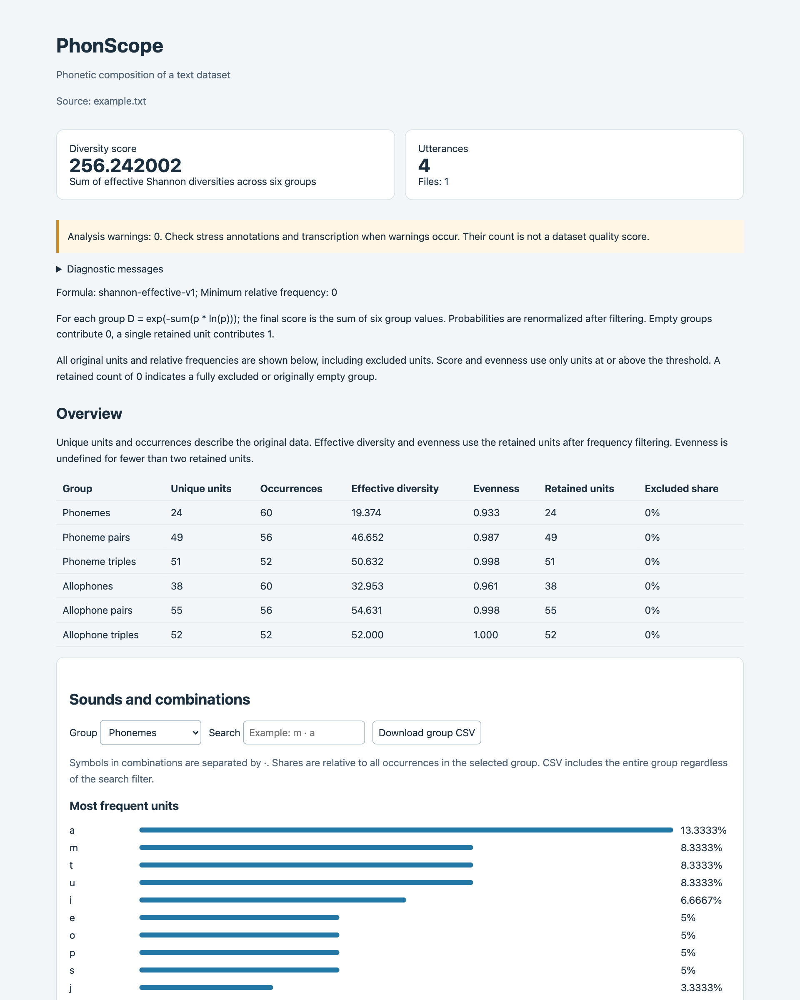
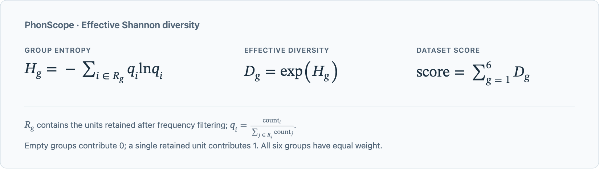

# PhonScope

PhonScope analyzes the phonetic composition of Russian text datasets: a frequency-aware
diversity score, evenness, sound and combination frequencies, and missing expected units.
Transcription uses RuTranscript and follows standard literary pronunciation.

## Features

- Frequency-aware phonetic diversity and evenness
- Separate phoneme and allophone statistics for single sounds, pairs and triples
- Custom expected inventories and missing-unit diagnostics
- Dataset comparison using saved scores and complete frequency tables
- Standalone interactive HTML reports, JSON and Markdown output

## Requirements

- Python 3.12
- uv 0.11.11 or later
- `make` for installation from source and development

## Installation

In a cloned repository, create the environment and install locked dependencies:

```sh
make venv
make install
```

`make venv` creates `.venv` with Python 3.12; `make install` synchronizes it with `uv.lock`.

## Quick start

Analyze a dataset and open the resulting HTML report:

```sh
make analyze ARGS='path/to/dataset.csv --open'
```

Results are saved as `report.json`, standalone interactive `report.html` and `report.md`
in a new directory under `reports/`. Directory names contain local time, UTC offset and a
unique suffix; previous results are preserved. `--open` opens the HTML report in a browser.

```python
from phonscope import GroupName, analyze_dataset, compare_reports

report = analyze_dataset('path/to/dataset.txt', min_relative_frequency=0.001)
score = report.score
phoneme_evenness = report.groups[GroupName.PHONEMES].evenness
comparison = compare_reports('path/to/report-a', 'path/to/report-b')
```

The API returns Pydantic models. `report.model_dump_json(indent=2)` serializes analysis results.

Example HTML report for four utterances:



## Input data

Input is a UTF-8 file or a directory of `.txt` and `.csv` files; a BOM is accepted. Directories
are read in filename order without recursion, ignoring extension case and unrelated files.
CSV requires a comma delimiter and exactly one column named `text`; other columns are ignored.
Standard CSV quoting is required for fields containing commas or line breaks.

Each TXT line or CSV record is one utterance. Line breaks inside CSV text become spaces.
Overlapping sound pairs and triples cross word boundaries within an utterance, but never
utterance or file boundaries. Punctuation does not introduce extra boundaries; use separate
lines when a boundary is required. Stress, whitespace and pause markers are excluded.

Optional stress annotations use `+` before the stressed vowel. Single quotes are normalized
to double quotes for transcription. Empty utterances and utterances without sounds are skipped.
A nonexistent path or a dataset without transcribable utterances raises `ValueError`.
Reading and transcription failures propagate to the caller without returning a partial report.

## Metric

Phonemes and allophones are counted separately as single sounds, pairs and triples. For each
of these six groups, effective Shannon diversity is:



Here `q_i` is a unit's share among retained occurrences. The final `score` is the unweighted
sum of six `D` values, without normalization or a 0-100 limit. Ten equally frequent units
contribute 10; twenty units with one occupying 90% contribute approximately 1.858.

`min_relative_frequency` defaults to 0 and accepts values from 0 to 1 inclusive. It excludes
units whose original within-group share `count / total` is below the threshold; equality is
included. For example, `0.001` means **0.1%**. Retained shares are renormalized before scoring.

An empty retained group contributes 0; a single retained unit contributes 1. Both have
undefined evenness (`null`). For two or more units, Pielou evenness is `J = H / ln(K)`, where
`K` is the retained unit count. Values closer to 1 indicate a more even distribution.
Repeating utterances in the same proportions preserves diversity and evenness.

The result includes `score`, `metric` settings, input `files`, transcribed `lines` and `groups`.
Group fields distinguish original data from the retained distribution:

| Fields | Meaning |
| --- | --- |
| `total`, `unique`, `frequencies` | Original occurrences, unit count and frequency table |
| `retained_total`, `retained_unique` | Occurrences and unit count after filtering |
| `excluded_frequency` | Excluded share of original occurrences |
| `effective_diversity`, `evenness` | Statistics of the retained distribution |
| `missing` | Unobserved expected units; unaffected by filtering |

Frequency entries contain `unit`, `count` and `relative_frequency`. JSON represents units as
sound arrays, such as `["m", "a"]`. Formula references: [Shannon diversity](https://scikit.bio/docs/latest/generated/skbio.diversity.alpha.shannon.html)
and [Pielou evenness](https://scikit.bio/docs/dev/generated/skbio.diversity.alpha.pielou_e.html).

## Analysis options

```sh
make analyze ARGS='path/to/dataset.csv --language ru --min-frequency 0.001 --output reports/my-project'
make analyze ARGS='path/to/dataset.txt --expected expected.json'
make analyze ARGS='path/to/dataset.csv --format json' > report.json
make analyze ARGS='--help'
```

`--language` defaults to `en`; `ru` localizes readable reports. `--min-frequency` sets the
relative threshold. `--output` selects the parent directory for new report folders.
`--format json` writes machine-readable JSON to stdout, with diagnostics and the output path
on stderr. All three report formats are always saved. The default terminal output is a summary.
Exit codes: 0 on success, 1 on processing failure, 2 for invalid CLI arguments.

HTML supports search, sorting and pagination; single-dataset reports also provide charts and
CSV export of the complete selected group. Reports contain input paths and diagnostics,
which may include individual words, but do not include the original utterances.

## Expected units

By default, single-sound expectations use RuTranscript's `KNOWN_PHONEMES` and `ALPHABET`
inventories without boundary markers. Pairs and triples have no default inventory, so their
`missing` field is `null`. Expectations affect diagnostics only, never scores or counting.

Supply an `expected.json` file through `--expected`, or pass an `ExpectedUnits` model to the API:

```json
{
  "phonemes": ["a", "o"],
  "phoneme_bigrams": [["m", "a"]],
  "allophone_trigrams": []
}
```

Each supplied list replaces expectations for that group. An empty list produces `missing=[]`;
omitted fields or `null` preserve defaults. Symbols must match RuTranscript's representation.
Empty symbols, whitespace, boundary markers, unknown fields and incorrect combination lengths
are rejected. Duplicate expectations count once; custom symbols outside the inventory are allowed.

## Comparing datasets

`compare_reports()` reads `report.json` from two saved directories. Reports are validated
before comparison, including consistency of current-formula statistics with frequency tables.
Formula versions and thresholds must match. To explicitly compare incompatible or legacy reports,
pass `allow_incompatible=True`; all output formats then show a warning. Stored scores are preserved.

The larger score wins; numerically equal scores are a tie. Detailed tables show shared and
exclusive units, original counts, frequency differences and score inclusion status. HTML and
Markdown show percentages; JSON uses fractions. Legacy and unknown formula versions receive
structural validation without applying the current formula to their statistics.

For editable settings and saving comparison reports, use the clients below. Select the project's
`.venv/bin/python` in your IDE, edit the `if __name__ == '__main__'` block and run the file:

| Client | Purpose |
| --- | --- |
| `scripts/analyze.py` | Analyze one dataset and save reports |
| `scripts/compare.py` | Compare two saved report directories |
| `scripts/analyze_and_compare.py` | Analyze two datasets in parallel, then compare |

Clients expose input paths, `output_root`, report `language` and applicable analysis settings.
Use `Language.EN` or `Language.RU`. Default paths are relative to the project directory.
Parallel analysis uses more memory; if one worker fails, successful reports are preserved
and no comparison is created.

## Limitations

- The score is not normalized by dataset size and is not a statistical significance test.
- Pairs and triples can contribute more than single sounds. Compare all groups and dataset sizes.
- High evenness does not establish inventory coverage, natural speech frequencies or TTS/ASR quality.
- Results depend on transcription and utterance boundaries. Spontaneous speech, acoustics and
  target frequency distributions are not modeled.
- The current `shannon-effective-v1` metric replaces earlier coefficients and unique-count scores;
  previous results and TTS experiments do not validate it.

## Development

```sh
make ruff-check
make ty
make test
make package
```

These check formatting and lint rules, types, unit tests, and wheel/sdist builds respectively.
`make ruff` applies formatting and safe lint fixes. `make pre-commit` installs Git hooks,
including tests on every commit. Dependencies and tooling are configured in `pyproject.toml`;
update `uv.lock` with `make lock` after dependency changes.

Hatch-vcs derives package versions from `vMAJOR.MINOR.PATCH` Git tags; do not set them manually.
Repository builds require Git history with tags. CI checks code, tests, packaging and installed imports.

Changes are recorded in [CHANGELOG.md](CHANGELOG.md).

The project is developed with assistance from GPT-6.1 Sol.

## License

PhonScope is distributed under the [MIT License](LICENSE).
